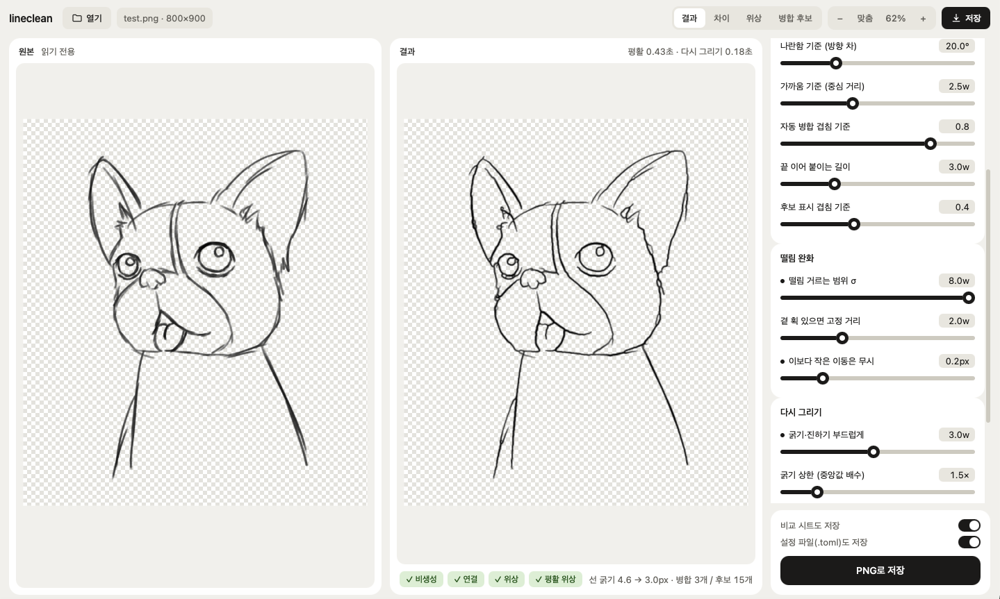

# art_line_clean

직접 그린 러프(RGBA PNG)를 원본 선의 위치·형태·비율을 유지한 채 깔끔한 선화로 정리하는 개인용 로컬 도구.
생성형 AI로 다시 그리는 방식이 아니라, 원본 선을 분석해 정리한다. 원본에 없는 선은 만들지 않는다.



**하는 일**
- 덧그은 선을 대표 선 하나로 병합
- 미세한 떨림 완화 (모서리·교차·분기는 유지)
- 굵기·가장자리를 정리해 깔끔한 선으로 다시 그리기 (원하는 선 굵기 지정 가능)
- 처리 전후 검사: 원본 밖 잉크가 생기지 않았는지, 선이 새로 붙거나 끊기지 않았는지

## 상태
개발 중 — 진행 상황은 [docs/ROADMAP.md](docs/ROADMAP.md) 참고.

## 설치 (PowerShell)
```powershell
uv sync
```
Windows는 화면을 WebView2(Edge) 런타임으로 그린다. Windows 10/11에는 보통 설치되어 있다.

## 실행
프로젝트 폴더에서 실행한다.

```powershell
uv run python -m lineclean.gui                              # 창을 열고 PNG를 끌어다 놓기
uv run python -m lineclean.gui .\samples\input\rough.png    # 그림을 연 채로 시작
uv run python -m lineclean.gui --browser                    # 창 대신 브라우저에서 (127.0.0.1, Ctrl+C로 종료)
```

창을 닫으면 프로그램도 끝난다. 원본 파일은 절대 바뀌지 않는다.

## 화면 구성
| 원본 (왼쪽) | 결과 (가운데) | 파라미터 (오른쪽) |
|---|---|---|
| PNG를 끌어다 놓는 칸 (읽기 전용) | 정리된 결과. 위쪽에서 보기를 바꾼다 | 단계 켜고 끄기, 슬라이더, 저장 |

두 그림 칸은 확대·이동이 함께 움직인다 (휠로 확대, 끌어서 이동).
결과 칸 아래에는 검사 결과 칩과 처리 요약(선 굵기 변화, 병합 수)이, 위쪽에는 단계별 계산 시간이 나온다 (맨 위 그림 참고).

## 사용 순서
1. **열기** — PNG를 **원본 칸**에 끌어다 놓거나 **열기** 버튼(⌘O / Ctrl+O)을 누른다. 결과 칸에는 놓을 수 없다.
2. **단계 고르기** — 오른쪽 **단계** 카드에서 켠다.
   - 덧그림 병합: 끄기 / 자동(확실한 것만) / 고르기(직접 고른 것만)
   - 떨림 완화, 다시 그리기: 스위치
3. **파라미터 조정** — 슬라이더를 움직이면 결과가 다시 계산된다 (놓을 때, 또는 0.3초 멈출 때). 바꾼 단계부터만 다시 계산해서 빠르다.
   - 처음에는 자주 쓰는 항목만 보인다. 나머지는 **고급 설정 보기**에 있다 (`주의` 표시는 바꾸면 결과가 크게 달라지는 값).
   - 이름에 마우스를 올리면 설명이 나오고, **더블클릭하면 기본값**으로 돌아간다. ●는 기본값과 다른 값이다.
4. **결과 보기** — 위쪽 보기 버튼으로 바꾼다.
   - 결과 / 차이(빨강: 생긴 잉크, 파랑: 사라진 잉크) / 위상(교차·분기·끝점) / 병합 후보
5. **덧그림 병합 후보 고르기** — **병합 후보** 보기에서 선이나 번호를 클릭해 고르거나 뺀다. 자동 모드에서 클릭하면 고르기 모드로 바뀐다.
   - 초록: 병합됨 · 주황: 고르지 않음 · 빨강 `번호 ✕`: 골랐지만 병합하지 않음 (애매하면 합치지 않는다. 이유는 알림과 툴팁에)
6. **검사 확인** — 결과 아래 칩(비생성·연결·위상·평활 위상)이 초록이면 통과. 마우스를 올리면 무엇을 검사했는지와 현재 상태가 나온다.
7. **저장** — **PNG로 저장**(⌘S / Ctrl+S). 새 파일로만 저장한다 (기존 파일·입력 폴더에는 쓰지 않음). 기본 위치는 `output\`.
   - 함께 저장(선택): 비교 시트 `_compare.png`, 설정 `_settings.toml`
   - 원본에 없는 잉크가 생긴 결과(비생성 위반)는 저장하지 않는다.

### 자주 쓰는 파라미터
| 카드 | 이름 | 하는 일 |
|---|---|---|
| 다시 그리기 | 목표 선 굵기 | 원하는 선 굵기(px). 0이면 원본 굵기. 가늘게 하면 그만큼 진하게 그려 잉크 양을 유지 |
| 선 구조 읽기 | 자동 잉크 판정 비율 | 진한 선 옆의 옅은 번짐을 잉크로 보지 않는 정도. 가까운 선이 붙으면 올리고, 촘촘한 덧그림이 안 합쳐지면 내린다 (0 = 끔) |
| 덧그림 병합 | 자동 병합 겹침 기준 | 자동 모드에서 이만큼 겹친 후보만 합친다 |
| 다시 그리기 | 번짐 폭 빼기 | 결과 선이 원본보다 가늘어 보이면 내린다 |
| 다시 그리기 (고급) | 중심선 다듬기 σ | 올리면 선이 더 매끈해진다 (너무 크면 모서리가 둥글어짐) |

### 단축키
| 키 | 동작 |
|---|---|
| ⌘O / Ctrl+O | 열기 |
| ⌘S / Ctrl+S | 저장 |
| 0 | 화면에 맞춤 |
| 1 | 실제 크기(100%) |

## 설정 파일
시작 설정은 현재 폴더의 `lineclean.toml`이다 (없으면 코드 기본값). 모든 파라미터와 설명은 템플릿
[lineclean.default.toml](lineclean.default.toml)에 있다. 템플릿은 고치지 말고 복사해서 쓴다. `lineclean.toml`은 git에 올라가지 않는다.

```powershell
Copy-Item lineclean.default.toml lineclean.toml
```

GUI에서 저장한 `_settings.toml`도 같은 형식이라, 마음에 든 설정을 `lineclean.toml`로 복사해 다음 시작 설정으로 쓸 수 있다.
다른 설정으로 시작하려면 `--config`를 준다.

```powershell
uv run python -m lineclean.gui --config .\output\rough_clean_settings.toml
```

## 명령행 (CLI)
GUI와 같은 처리를 명령으로 실행한다. 여러 장을 처리하거나 GUI에서 저장한 결과를 다시 만들 때 쓴다.
GUI에서 저장한 `_settings.toml` 맨 위에 같은 결과를 만드는 명령이 적혀 있다.

```powershell
# 병합(자동) + 떨림 완화 + 다시 그리기
uv run python -m lineclean .\samples\input\rough.png -o .\output\rough_clean.png --merge --smooth --render

# 고른 후보만 병합 (번호는 --merge로 만든 <출력>_merge_overlay.png와 _merge_log.csv에서 확인)
uv run python -m lineclean .\samples\input\rough.png -o .\output\rough_clean.png --merge-ids 3,7 --smooth --render

# 다른 설정 파일로
uv run python -m lineclean .\samples\input\rough.png -o .\output\try1.png --merge --render --config configs\try1.toml
```

| 옵션 | 내용 |
|---|---|
| `--merge` | 덧그림 병합 (확실한 후보만 자동). 후보 오버레이·기록 CSV도 저장 |
| `--merge-ids N,N` | 고른 후보만 병합 |
| `--smooth` | 떨림 완화 (원본 픽셀을 최대 1px 옮김) |
| `--render` | 깔끔한 선화로 다시 그리기 |
| `--topology-overlay` | 획과 교차점을 그린 `<출력>_topology.png` 저장 |
| `--config 파일` | 설정 파일 지정 |
| `--sheet 파일` / `--no-sheet` | 비교 시트 경로 지정 / 만들지 않음 |

옵션이 없으면 그대로 복사한다(항등). 처리 후에는 비생성·연결·위상 검사 결과를 출력하고, 실패하면 종료 코드 1이다.

## 개발 (PowerShell)
```powershell
uv run pytest                                             # 테스트
uv run python -m lineclean.synthetic .\samples\synthetic  # 합성 테스트 이미지 생성 (기존 파일은 건너뜀)
uv run python experiments\m1_extract.py                   # M1 선 그래프 추출 실험 → output\m1\
```

## 폴더
- `src/lineclean/` 코드 (`gui/`는 GUI) · `tests/` 테스트 · `samples/input/` 원본(읽기 전용)
- `samples/synthetic/` 합성 테스트 이미지 · `output/` 결과물(git 제외)

## 문서
- [요구사항](docs/REQUIREMENTS.md) · [설계·검증](docs/DESIGN.md) · [로드맵](docs/ROADMAP.md) · [결정 기록](docs/DECISIONS.md)
