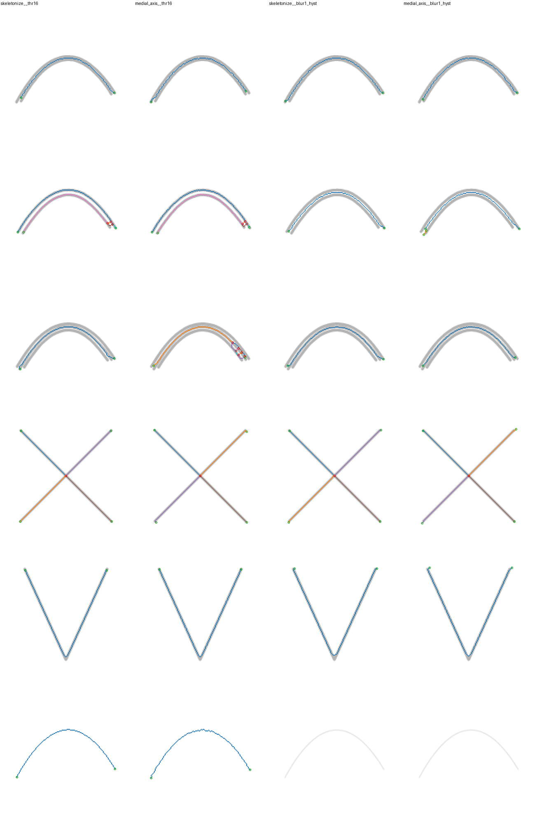

# M1 실험 보고서 — 선 그래프 추출 방식 비교

- 날짜: 2026-11-01
- 재현: `uv run python experiments/m1_extract.py` → `output/m1/` (git 제외)
- 상태: **완료. 사용자가 §6의 대안 A(블러 없음)를 선택 → DECISIONS D-8**

## 1. 무엇을 비교했나
| 조합 | 마스크 | 스켈레톤 |
|---|---|---|
| `skeletonize__thr16` | α ≥ 16 | `skimage.morphology.skeletonize` |
| `medial_axis__thr16` | α ≥ 16 | `skimage.morphology.medial_axis` |
| `skeletonize__blur1_thr16` | 가우시안 σ=1 → α ≥ 16 (블러 단독, 추가 실험) | skeletonize |
| `medial_axis__blur1_thr16` | 같음 | medial_axis |
| `skeletonize__blur1_hyst` | 가우시안 σ=1 → 히스테리시스(low 16, high 64) | skeletonize |
| `medial_axis__blur1_hyst` | 같음 | medial_axis |

- 모든 조합에 잔가지 가지치기를 적용했다 (끝점–분기점 엣지 중 길이 < 2 × 반지름).
- 대상
  - 합성 케이스 15개: `EXPECTED_TOPOLOGY`(사람이 기대하는 끝점·분기점·엣지 수)와 비교
  - 실제 러프 `rough_sketch.png` 전체와 확대 영역 3곳

## 2. 결과

### 합성 케이스 (가지치기 후, 정답 위상과 일치한 수)
| 조합 | 일치 | 틀린 케이스 |
|---|---|---|
| skeletonize__thr16 | 14/15 | overdraw2_gap3: 두 선으로 남고 끝에서 붙어 고리 1개 |
| medial_axis__thr16 | 12/15 | overdraw2_gap0(두 갈래로 갈라짐), overdraw2_gap3, overdraw3_gap1(고리 4개) |
| skeletonize__blur1_thr16 | **15/15** | — |
| medial_axis__blur1_thr16 | 12/15 | overdraw2_gap3, junction_t·branch_y(분기점 차수 2) |
| skeletonize__blur1_hyst | 14/15 | **faint_thin: 선 전체가 사라짐** |
| medial_axis__blur1_hyst | 13/15 | branch_y, **faint_thin 사라짐** |

medial_axis는 실행할 때마다 결과가 조금씩 다르다. skimage의 `medial_axis`가 내부에서 난수로 순서를 정하기 때문이다. 표의 medial_axis 수치는 마지막 실행 기준이다.

위 이미지의 행: overdraw2_gap1, overdraw2_gap3, overdraw3_gap1, cross_x, sharp_corner, faint_thin
초록 = 끝점, 빨강 = 분기점, 색 = 엣지

참고: gap1 덧그림은 thr16에서도 하나로 합쳐졌다. 안티앨리어싱 번짐 때문에 1px 틈의 알파가 16을 넘어 한 덩어리가 되었기 때문이다. 틈이 "보이는" 정도(3px)가 되어야 문제가 드러난다.

### 실제 러프 (900×1100)
| 조합 | 끝점 | 분기점 | 엣지 | 고리 | 시간 |
|---|---|---|---|---|---|
| skeletonize__thr16 | 90 | 300 | 544 | 174 | 1.1s |
| medial_axis__thr16 | 96 | 349 | 626 | 201 | 1.4s |
| skeletonize__blur1_thr16 | 58 | 99 | 184 | 43 | 0.4s |
| medial_axis__blur1_thr16 | 58 | 125 | 219 | 52 | 0.5s |
| skeletonize__blur1_hyst | 50 | 99 | 181 | 43 | 0.4s |
| medial_axis__blur1_hyst | 48 | 119 | 206 | 49 | 0.5s |

그림에 있는 실제 획은 수십 개 수준이다. 어느 조합도 이와 가깝지 않다. 분기점과 고리 대부분은 진짜 교차가 아니라 덧그림이 군데군데 닿아 생긴 **사다리 모양 고리**다.

확대 오버레이는 로컬에만 있다 (원본 그림이므로 커밋하지 않음): `output/m1/<조합>/REAL_{hair_side,eyes_guide,neck_cross}_overlay.png`

## 3. 실패 양상 정리
| 양상 | 어디서 | 원인 |
|---|---|---|
| 덧그림이 합쳐지지 않음 | thr16, 틈 ≥ 약 2px | 세선화는 연결성을 보존한다. 떨어진 선은 떨어진 채로 남는다 |
| 사다리 고리 | thr16 실제 러프 (머리 옆, 목, 어깨) | 덧그은 선이 몇 군데에서만 닿음 → 닿는 곳마다 분기점 2개와 고리 1개 |
| 잔가지 | medial_axis > skeletonize | 연필 질감의 들쭉날쭉한 가장자리. medial_axis가 더 민감함 |
| 희미한 선 소실 | 히스테리시스 | 블러 후 α ≥ 64인 "씨앗" 픽셀이 없는 선은 통째로 버려짐 (faint_thin, 실제 보조선) |
| 모서리가 짧아짐 | blur1 조합의 sharp_corner | 블러가 V자 끝을 둥글게 만들어 스켈레톤이 꼭짓점까지 가지 않음 |
| 교차가 여러 분기점으로 쪼개짐 | 실제 러프 목–어깨 X | 교차하는 선 자체가 덧그림이라 교차점 주변이 여러 덩어리가 됨 |

**구현 중 발견하고 고친 문제**

분기점 판정을 "이웃 수 ≥ 3"에서 "이웃 덩어리 수 ≥ 3 또는 이웃 ≥ 4"로 바꿨다. 이유는 두 가지다.
- 계단 모서리를 분기점으로 잘못 잡는 문제
- 대각선 두 선이 픽셀 사이에서 교차할 때(2×2 블록) 교차점을 놓치는 문제

둘 다 `tests/test_graph.py`에 테스트로 고정했다.

## 4. 해석
1. **skeletonize > medial_axis.**
   - medial_axis는 모든 지표에서 더 나쁘다(잔가지·분기점 증가, 3~4배 느림).
   - medial_axis의 장점인 반지름은 거리 변환으로 skeletonize에도 똑같이 붙일 수 있다.
2. **블러는 덧그림을 합쳐 주지만 판단 없이 합친다.**
   - σ가 사실상 "이 거리 안의 선은 모두 합친다"는 전역 파라미터가 된다.
   - 얼굴 윤곽 위에 2~3px 간격으로 겹친 머리카락 선도 똑같이 합쳐진다. 원칙 3(애매하면 합치지 않는다)과 충돌한다.
   - 모서리도 무디게 만든다.
3. **히스테리시스는 보조선을 "우연히" 지운다.** 실제 러프에서 십자선이 사라졌다. 하지만 같은 이유로 진짜 희미한 선(faint_thin)도 지운다. 보조선 제거(D-9)는 이렇게 암묵적으로 하면 안 되고, 판정 기준이 보이는 별도 단계여야 한다.
4. **결론: 스켈레톤은 출발점으로는 쓸 만하지만, 덧그림 병합은 스켈레톤 단계가 아니라 그래프 단계에서 해야 한다.**
   - thr16 스켈레톤 그래프에서 덧그림은 "나란히 가는 두 엣지"나 "사다리 고리"로 드러난다. 찾을 수 있는 형태다.
   - 이것을 찾아 판정 근거(간격, 방향 차이, 겹친 길이)와 함께 병합하는 것이 M2다.

## 4-1. 추가 실험: 블러 단독 (σ=1, 히스테리시스 없음)
처음 보고서에서는 블러와 히스테리시스의 효과가 섞여 있었다. 그래서 "블러 → α ≥ 16" 조합을 추가했다.
더 자세히 보기 위해 흔들림 없는 평행 두 선을 간격별로 만들어 측정했다 (`skeletonize` + 가지치기).

**블러 단독의 효과**
- 실제 러프의 분기점·고리 감소(300 → 99, 174 → 43)는 **거의 전부 블러 덕분**이다. 히스테리시스를 더해도 거의 같다(99, 43).
- 블러 단독은 희미한 선을 지우지 않는다.
  - 합성 15/15 일치, faint_thin 유지
  - 실제 러프 십자선도 남음 (x≈450 세로선 구간: thr16 173px → blur1 144px)
  - 즉 희미한 선 소실의 원인은 히스테리시스다.

**하지만 블러는 사다리 문제를 없애지 못하고 더 넓은 간격으로 옮길 뿐이다** (평행 두 선, 가장자리 간격별 결과)

| 간격 | thr16 | blur σ=0.5 | blur σ=1 |
|---|---|---|---|
| 1px | 1선 | 1선 | 1선 |
| 2px | **사다리 (엣지 72, 고리 30)** | 1선 | 1선 |
| 3px | 2선 | **사다리 (엣지 85, 고리 35)** | 1선 |
| 4px | 2선 | 2선 | **사다리 (엣지 6, 고리 2)** |
| 5~6px | 2선 | 2선 | 2선 |

어떤 설정이든 "합쳐지는 간격"과 "분리되는 간격" 사이에 사다리가 생기는 경계 간격이 있다.
- 블러를 키우면 그 경계가 바깥으로 밀려날 뿐이다.
- 그만큼 더 넓은 간격의 서로 다른 선이 판단 없이 합쳐진다.
- 실제 러프 확대에서도 확인했다. 오른쪽 어깨의 2중선(간격 약 4~5px)은 thr16에서 깨끗한 두 선이었는데, blur1에서는 사다리 고리가 되었다.

**모서리**: V자 꼭짓점에서 가장 가까운 스켈레톤까지의 거리
- thr16: 4px
- blur σ=0.5: 5px
- blur σ=1: 6px

## 5. 보조선 구분 가능성 (실제 러프, skeletonize__thr16)
길이 40px 이상인 엣지 53개를 평균 알파 순으로 정렬했다.
- 가장 옅은 6개가 정확히 얼굴 십자선 조각이었다 (x≈450 세로, y≈525 가로).
  - 평균 알파 33~52
  - 반지름 ≈ 1.0
  - 직진도 ≥ 0.95
- 그다음 엣지들은 알파 77 이상, 반지름 1.2 이상이었다.

이 그림 한 장에서는 "옅음 + 가늘음 + 곧음 + 김"으로 깨끗하게 갈린다. 다만 다음 한계가 있다.
- 표본이 1장뿐이다.
- 합성 faint_thin(알파 ≤ 90)처럼 의도한 희미한 선과 경계가 가깝다.
- 십자선이 다른 선과 만나는 곳에서 조각나므로, 조각을 이어 붙인 뒤 판정해야 한다.

## 6. 제안 (D-8 후보, 승인 필요)
- **추출 방식**: `skeletonize`, 마스크는 `threshold α ≥ 16`, 블러 없음. 반지름은 거리 변환으로 붙인다.
  - 블러를 빼는 이유(§4-1):
    - 그래프 개수는 크게 줄여 주지만, 사다리를 없애는 게 아니라 경계 간격을 옮길 뿐이다.
    - 그 안쪽의 선은 근거 없이 합친다.
    - 모서리를 2px 더 무디게 만든다.
  - 어차피 M2에 그래프 단계 병합이 필요하다면, 병합은 판정 근거가 남는 한 곳(M2)에서만 하는 편이 원칙 3에 맞다.
  - 대안 B: σ=0.5 정도의 약한 블러를 전처리로 둔다. 연필 질감 잔가지가 줄어드는 대신 약 2px 이하 간격의 선은 판단 없이 합쳐진다. 사용자가 이 대가를 받아들이면 선택할 수 있다.
- **잔가지 가지치기**: 유지 (factor 2).
- **M2 방식**: 스켈레톤 그래프 위에서 덧그림 후보를 찾는다.
  - 후보: 사다리 고리, 그리고 가까이 나란히 가는 엣지 쌍
  - 판정: 간격 ≤ k × 선 굵기, 접선 각도 차 ≤ θ, 겹친 길이 비율
  - 병합: 대응점을 정렬(DTW 등)한 뒤 중간 경로 M(t)로 대체
  - 판정이 애매하면 합치지 않는다
  - 비생성 검사로 결과를 제한한다
- **기각**: 블러 σ ≥ 1을 병합 수단으로 쓰는 것 (판단 없는 병합, 모서리 손상), 히스테리시스 기본 사용 (희미한 선 소실), medial_axis.

## 7. 한계와 남은 질문
- 실제 러프 표본이 1장이다.
- 평행선 간격 측정(§4-1)은 흔들림 없는 깨끗한 선으로 했다. 실제 덧그림은 간격이 구간마다 달라서, 한 선 안에서도 합쳐지는 구간·사다리 구간·분리 구간이 섞인다.
- 합성 오버레이 이미지(`m1_synthetic_overlays.png`)에는 처음 4개 조합만 들어 있다.
- 오버레이로 본 판단은 사람(Claude) 판단이다. 실제 러프 확대 오버레이를 사용자가 직접 확인하길 권한다.
